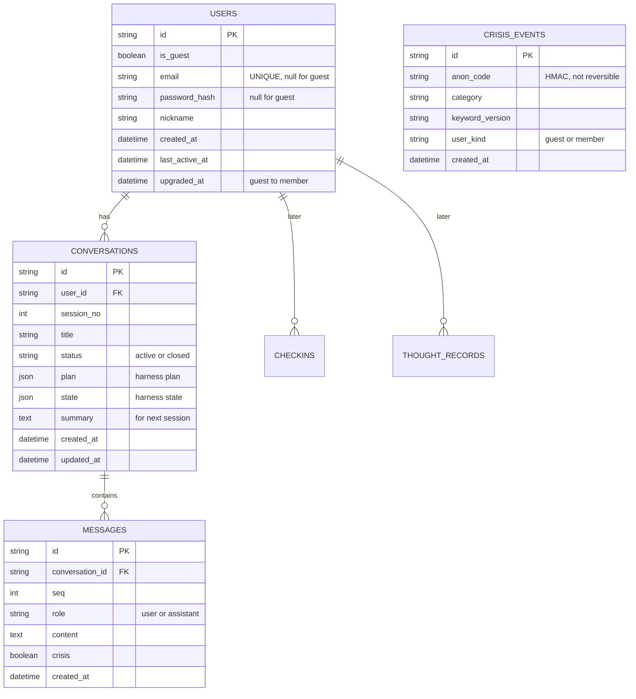

# Synap DB 설계 (초안)

> 상태: **초안** — 현수와 합의 후 확정. `미정`은 합의가 필요한 항목.
> 기준 문서: [`api-spec.md`](api-spec.md), 모델 하네스(`model/eval/cbt_multiturn_experiments/code/qwen_replay_20261007/cbt_harness.py`)

## 1. 설계 방향

- **로컬은 SQLite, 배포는 Supabase(Postgres)**. SQLAlchemy 2.0 + Alembic으로 같은 모델을 양쪽에서 쓴다.
  - ID는 UUID 문자열, JSON 컬럼은 SQLAlchemy `JSON` 타입(Postgres에서는 `jsonb`로 동작)을 쓴다.
- **비회원과 회원은 같은 `users` 테이블**에 두고 `is_guest`로 구분한다. 가입하면 같은 행을 회원으로 바꾸기만 해서, 대화가 자동으로 이어진다. (별도 이관 작업 없음)
- **회기(session) = `conversations` 한 행**. 비회원이 몇 회기를 했는지는 대화 수를 세서 계산하므로 `signup_required`용 컬럼은 따로 두지 않는다.
- **상담 진행 상태는 서버가 저장한다.** 모델 하네스가 회기마다 `plan`(상담 계획)과 `state`(진행 메모)를 만들기 때문에, 이를 대화에 JSON으로 붙여둔다. 하네스 구조가 바뀔 수 있어 컬럼으로 쪼개지 않는다.

## 2. ERD

`CRISIS_EVENTS`는 **다른 테이블과 FK를 걸지 않는다.** (사용자·대화와 연결되지 않게 하려는 의도)
`CHECKINS`, `THOUGHT_RECORDS`는 후속 범위라 4절에서 개요만 적는다.

## 3. 테이블 상세

### 3.1 `users`
| 컬럼 | 타입 | 제약 | 설명 |
|---|---|---|---|
| id | UUID | PK | |
| is_guest | bool | NOT NULL, 기본 true | 비회원 여부 |
| email | text | UNIQUE, NULL 허용 | 회원만 |
| password_hash | text | NULL 허용 | 회원만 (bcrypt/argon2) |
| nickname | text | NULL 허용 | |
| created_at | timestamptz | NOT NULL | |
| last_active_at | timestamptz | NOT NULL | 보관 기간 계산 기준 |
| upgraded_at | timestamptz | NULL 허용 | 비회원 → 회원 전환 시각 |

- 체크 제약: `is_guest = false`이면 `email`과 `password_hash`가 NULL이 아니어야 한다.
- `POST /auth/guest`: `is_guest=true` 행 생성. `POST /auth/register`/`upgrade`: 같은 행을 `is_guest=false`로 바꾸고 이메일·비밀번호를 채운다.

### 3.2 `conversations`
| 컬럼 | 타입 | 제약 | 설명 |
|---|---|---|---|
| id | UUID | PK | |
| user_id | UUID | FK → users.id, ON DELETE CASCADE, 인덱스 | |
| session_no | int | NOT NULL | 사용자별 회기 번호(1부터) |
| title | text | NULL 허용 | |
| status | text | NOT NULL, 기본 `active` | `active` / `closed` |
| plan | JSON | NULL 허용 | 하네스 `CounselingPlan` (technique, focus, steps, uncertainties) |
| state | JSON | NULL 허용 | 하네스 `SessionState` (stage, confirmed_facts, answered_questions, rejected_hypotheses, client_feedback, next_action, client_requested_stop) |
| summary | text | NULL 허용 | 회기 요약(JSON 문자열: situation, first_thought, emotions[], findings, alternative, next_action). 다음 대화에서 모델에게 "기억"으로 넘기며 사용자에게는 보여주지 않는다 |
| summary_seq | int | NULL 허용 | 요약이 반영한 마지막 메시지 seq. 이어서 대화하면 `summary_seq < 마지막 seq` 가 되어 다시 요약한다 |
| created_at / updated_at | timestamptz | NOT NULL | |

- UNIQUE(`user_id`, `session_no`)
- 인덱스: (`user_id`, `updated_at` DESC) — 목록 조회용

### 3.3 `messages`
| 컬럼 | 타입 | 제약 | 설명 |
|---|---|---|---|
| id | UUID | PK | |
| conversation_id | UUID | FK → conversations.id, ON DELETE CASCADE | |
| seq | int | NOT NULL | 대화 안의 순번 |
| role | text | NOT NULL | `user` / `assistant` |
| content | text | NOT NULL | |
| crisis | bool | NOT NULL, 기본 false | 위기 키워드 감지로 만든 응답인지 |
| created_at | timestamptz | NOT NULL | |

- UNIQUE(`conversation_id`, `seq`)

### 3.4 `crisis_events` (비식별 위기 감지 기록)
| 컬럼 | 타입 | 설명 |
|---|---|---|
| id | UUID PK | |
| anon_code | text | `HMAC-SHA256(user_id, CRISIS_LOG_SECRET)`의 앞부분. 되돌릴 수 없는 비식별 코드 |
| category | text | 감지된 키워드 그룹 (예: `self_harm`). **원문·키워드 자체는 저장하지 않음** |
| keyword_version | text | 키워드 목록 버전 (필터 개선 추적용) |
| user_kind | text | `guest` / `member` |
| created_at | timestamptz | |

- 저장하지 않는 것: 사용자 ID, 대화 ID, 메시지 내용, 이메일, IP.
- 계정이 삭제돼도 이 기록은 남는다 (FK 없음). 같은 사람의 반복 감지는 `anon_code`로만 셀 수 있다.
- `CRISIS_LOG_SECRET`은 환경변수로만 관리하고, 바뀌면 이전 코드와 이어지지 않는다.
- 주의: 코드 자체는 **가명(pseudonym)** 이라 비밀키와 사용자 ID를 모두 가진 쪽은 다시 연결할 수 있다. 완전 익명이 필요하면 `anon_code`를 아예 두지 않고 건수만 센다. (`미정`)
- 이 기록의 보관 기간은 `미정` (초안: 통계 목적이라 180일).

## 4. 후속 테이블 (개요만)

- `checkins`: user_id, mood(1~10), note, created_at
- `thought_records`: user_id, situation, automatic_thought, distortion_tags(JSON), alternative_thought, created_at
- 범위와 항목은 CBT 기능 합의 후 확정한다.

## 5. 보관 기간 (30~60일)

| 대상 | 초안 | 기준 |
|---|---|---|
| 비회원 계정과 그 대화 전체 | **30일** | `last_active_at` 이후 |
| 회원의 대화·메시지 내용 | **60일** | 해당 `conversations.updated_at` 이후 |
| 회원 계정(이메일·닉네임) | 탈퇴 전까지 유지 | |
| `crisis_events` | 180일 (`미정`) | `created_at` 이후 |

- 기간은 환경변수로 뺀다: `GUEST_RETENTION_DAYS=30`, `MEMBER_RETENTION_DAYS=60`.
- 삭제는 하루 1회 정리 작업으로 처리한다. Vercel Cron 또는 Supabase `pg_cron`으로 실행하고, 삭제는 FK `ON DELETE CASCADE`로 메시지까지 따라간다.
- 사용자가 직접 대화를 삭제(`DELETE /conversations/{id}`)하거나 탈퇴하면 즉시 삭제한다.
- `미정`: 회원이 60일 지난 대화를 잃으면 `summary`도 함께 사라져서, 이전 회기를 이어가는 흐름이 끊긴다. 요약만 더 오래 보관할지는 모델 방향 확정 후 결정한다.
- 서비스 화면에 보관 기간을 안내해야 한다.

## 6. Supabase 사용 시 주의

- 인증은 Supabase Auth가 아니라 **직접 만든 JWT**를 쓰므로, `users`는 우리 테이블이다.
- 백엔드는 Supabase의 Postgres **연결 문자열**로만 접속한다 (`DATABASE_URL`).
- Supabase는 기본적으로 `anon` 키로 테이블 API가 열릴 수 있으므로, 모든 테이블에 **RLS(행 수준 보안)를 켜고 정책을 두지 않는다**. 그러면 백엔드(서버 권한)만 접근한다. 상담 내용이 들어 있어 필수 항목이다.
- `anon`/`service_role` 키는 프론트와 레포에 두지 않는다.

## 7. 합의가 필요한 항목 (`미정` 모음)

1. 보관 기간 확정값 (초안: 비회원 30일, 회원 대화 60일)
2. `summary` 보관 방식 (대화와 같이 삭제 vs 요약만 연장)
3. `crisis_events`: 가명 코드 vs 건수만 저장, 보관 기간
4. 하네스 `plan`/`state` JSON의 필드 변경 가능성 (현수·모델 쪽 확인)
5. 대화 내용 암호화(앱 레벨) 여부
