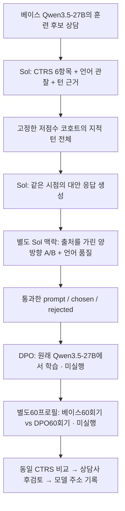

# Qwen3.5-27B CBT DPO 연구 파이프라인

목표는 **DPO를 학습한 Qwen3.5-27B가 원래 Qwen3.5-27B보다 새로운 내담자 프로필에서 더 좋은 상담을 하는지** 확인하는 것이다. 추가 SFT나 기존 데이터 전면 개편은 포함하지 않는다.

현재 단계: 베이스60회기 생성·CTRS 평가·선호 후보 구성·가상 편집본 평가 완료. **DPO 학습, 학습 모델의 최종60프로필 비교, 모델 배포는 아직 실행하지 않았다.**

## 읽는 순서

1. [실험 파이프라인과 결정 사항](docs/PIPELINE.md)
2. [실제 프롬프트·코드 대응표](docs/PROMPTS_AND_CODE.md)
3. [지금까지의 결과](docs/RESULTS.md)
4. [실행 방법과 입력 형식](docs/RUNNING.md)
5. [최종 평가 설계](docs/FINAL_EVALUATION.md)
6. [평가 후 모델·서비스 주소 기록](docs/MODEL_RELEASE.md)

Sol은 모델 가중치를 별도로 학습한 평가기가 아니라 `gpt-6.1-sol`, reasoning low에 역할별 프롬프트를 적용한 것이다. 생성·회기 평가·선호 비교는 각각 새 맥락이며 도구를 비활성화한다. 현 실험은 API가 아니라 ChatGPT 로그인 Codex 별도 실행이었다.

이 폴더는 로컬 실험 코드를 독립 실행형으로 이식한 연구용 참조 구현이다. 프롬프트360개·생성 입력78개를 원본과 오프라인 대조했다([결과](results/port_parity.json)). 공개 이식본에서 실제 모델 호출은 수행하지 않았다. 원래 구현의 파일 해시와 실제 사용 척도 출처는 [provenance.json](provenance.json)에 있다.

원래6개 척도는 과거 실험이 실제 사용한 `prompts_relaxed` 버전이다. 현재 저장소의 다른 CTRS 프롬프트로 임의 교체하지 않았다. [척도 해시](cbt_dpo/rubric_hashes.json)를 고정하고, 원래 채점본문에 언어·턴 근거 출력만 추가했다.

상담 원문·프로필·선호쌍 실데이터·계정 정보·가중치·원시 모델 캐시는 공개하지 않는다. 예시는 새 합성 형식 예시이며 학습·평가 실적에 포함하지 않는다.
